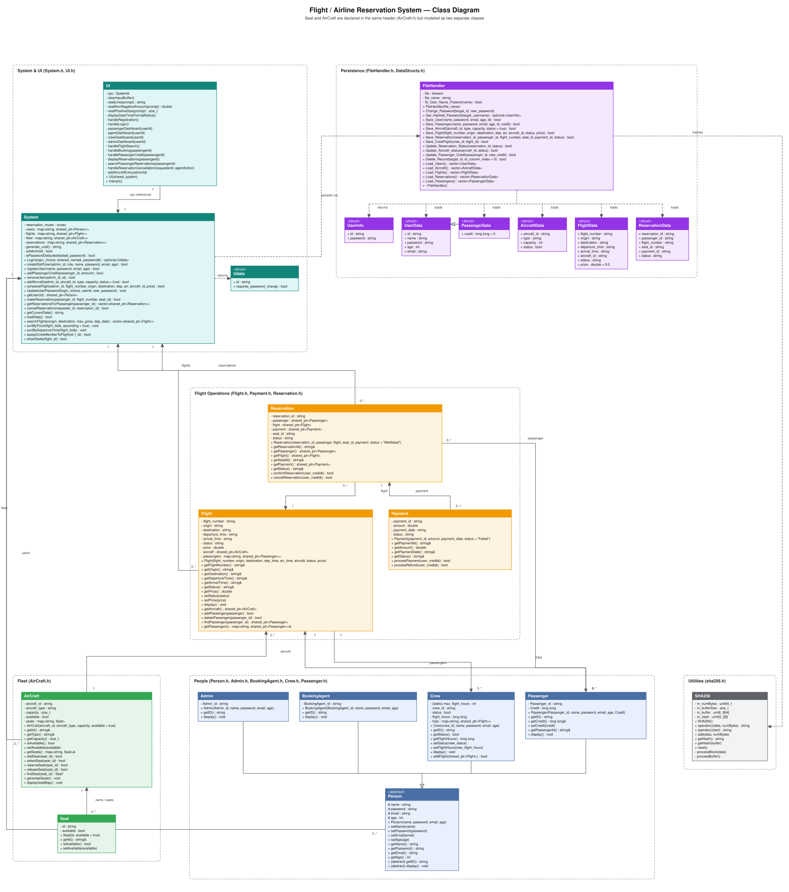

# Airline Reservation System

This is a C++17 command-line application that models the day-to-day running of an airline. It offers a separate interface for each of four roles (passengers, booking agents, crew members, and administrators) and keeps all of its records in simple CSV files, so no database setup is needed.



## Features

### Passengers

- Register and log in, with passwords stored as SHA-256 hashes
- Search flights by origin, destination, departure date, and maximum price, then sort by price or departure time
- Book a flight and pick a seat from an interactive seat map
- View, search, and cancel reservations (a cancellation refunds the fare to the wallet)
- Add credit to a wallet and pay for bookings with it
- Earn loyalty points on every booking. Once the balance reaches 5,000 points, the next booking gets a discount (up to 50, or half the fare if that is lower) and the points reset

### Booking agents

- Search flights, book seats for a passenger, view a passenger's reservations, and cancel bookings

### Crew members

- View assigned flight duties and their profile (including total flight hours)

### Administrators

- Schedule flights and add aircraft to the fleet
- Create and delete passenger, crew, booking agent, and admin accounts
- Assign crew members to flights. Assignments are rejected if they would push a crew member over the 40-hour flight limit

## Getting started

### Requirements

- A C++17 compiler (g++ recommended)
- `make`
- The **Boost** library (the project uses `boost/uuid` to generate unique IDs)

### Getting Boost

Boost is large (over 17,000 files), so it is not stored in this repository. Download it from Google Drive instead:

**[Download boost.zip](https://drive.google.com/file/d/1IsnMfnpPL2GW_huHN6c8rRtsXyqttcjU/view?usp=sharing)**

1. Download `boost.zip` from the link above.
2. In the project root, create a folder named `include` if it does not already exist.
3. Extract `boost.zip` into that folder. When you are done, the path `include/boost/uuid/` must exist.

The `Makefile` already looks for headers in `include/` (the `-Iinclude` flag), so no other setup is needed.

Alternatively, you can install Boost with a package manager instead, and skip the steps above:

- Ubuntu/Debian: `sudo apt install libboost-dev`
- Windows (MSYS2): `pacman -S mingw-w64-x86_64-boost`

### Build and run

```bash
make
./airline_system.exe
```

Run the program from the project root. It reads and writes the CSV files in `data/` using relative paths.

To clean up build files on Windows: `make clean`

### First login

The sample data includes one administrator:

| Role  | Username | Password |
|-------|----------|----------|
| Admin | admin    | Admin    |

`Admin` is treated as a default password, so the program asks you to choose a new one on the first login. From the admin dashboard you can then create booking agents, crew members, and more passengers. Passengers can also register themselves from the main menu.

### Typical walkthrough

1. Log in as admin and change the password.
2. Create a booking agent or crew member, or schedule a flight (a sample flight 101 is already included).
3. Back on the main menu, register a passenger and log in.
4. Add credit to the wallet, search for flights, and book a seat.

Flight times use the format `YYYY-MM-DD HH:MM`. Seat IDs are a row number followed by a letter, such as `12C`. Each row has six seats (A to F).

## Project structure

```
.
├── inc/          Header files
├── include/      Third-party headers (Boost, downloaded separately)
├── src/          Source files
├── data/         CSV "database" files
├── UML/          Class diagram
└── Makefile
```

| Class | Responsibility |
|-------|----------------|
| `Person` | Abstract base class for all users |
| `Passenger`, `BookingAgent`, `Crew`, `Admin` | Role-specific users derived from `Person` |
| `Flight`, `AirCraft`, `Seat` | Flight schedule, fleet, and seat map |
| `Reservation`, `Payment` | Booking flow, payment, and refunds |
| `System` | Core logic that ties everything together and enforces role permissions |
| `FileHandler` | Reads and writes the CSV files |
| `UI` | Menus and input handling for each role |
| `SHA256` | Password hashing |

## Data files

| File | Contents |
|------|----------|
| `Admin.csv`, `BookingAgent.csv`, `Crew.csv`, `Passengers.csv` | User accounts |
| `AirCraft.csv` | Fleet and capacities |
| `Flight.csv` | Scheduled flights |
| `Reservation.csv` | Bookings and their status |
| `CrewFlight.csv` | Crew-to-flight assignments |

## Design notes

- **Object-oriented design:** inheritance and polymorphism for the user roles, and `std::shared_ptr` for shared ownership of flights, aircraft, and passengers.
- **Safe booking flow:** a reservation takes payment, reserves the seat, and adds the passenger to the flight. If any step fails, the earlier steps are rolled back.
- **Seat protection:** a mutex guards booking so two reservations cannot claim the same seat at once.
- **Role-based access:** only admins can schedule flights, add aircraft, and manage accounts.

## Known limitations

- Passwords use unsalted SHA-256, which is fine for a learning project but not for production use.
- The CSV parser splits on commas, so names and emails must not contain commas.
- It is a single-user console application with no network or concurrent-user support.

## Credits

- The SHA-256 implementation (`inc/sha256.h`, `src/sha256.cpp`) is by Stephan Brumme.
- Unique IDs are generated with the [Boost](https://www.boost.org) UUID library.
